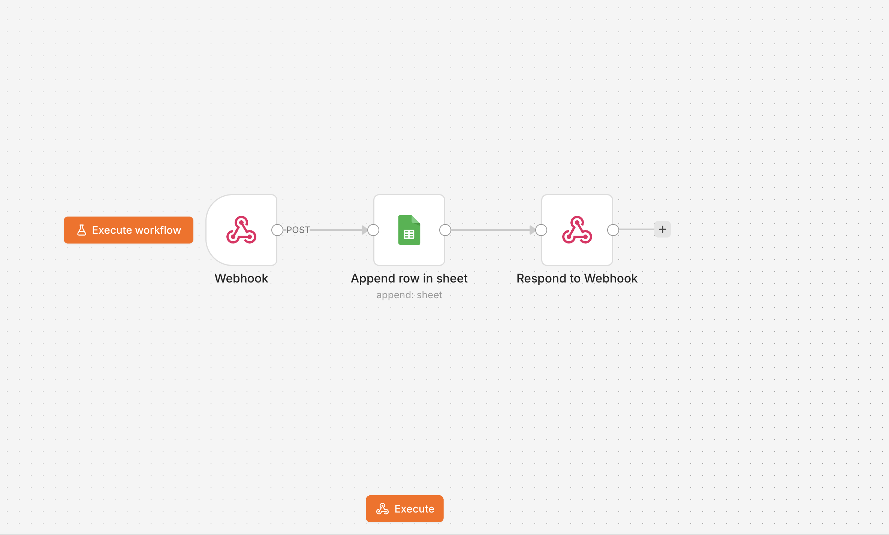

# n8n Webhook Form to Google Sheets

Automatically save HTML form submissions to Google Sheets using n8n and a webhook.
A beginner-friendly n8n automation tutorial, no coding required.

## What it does

A visitor submits a form, n8n receives it through a webhook, the data is added
as a new row in Google Sheets, and the sender gets a success response.

Flow: Webhook -> Google Sheets (Append Row) -> Respond to Webhook

## Requirements

- n8n (Cloud or self-hosted)
- A Google account

## Setup

1. Create a Google Sheet with these headers in row 1: name, email, message, submitted_at
2. In n8n, import workflows/form-to-google-sheets.json (Workflows > Import from file)
3. Connect your own Google Sheets credential and select your sheet
4. Save the workflow and set it to Active
5. Copy the Production URL from the Webhook node
6. Paste it into the action attribute of form.html
7. Open form.html in a browser and submit a test entry

## Expressions used in the Google Sheets node

- name: {{ $json.body.name }}
- email: {{ $json.body.email }}
- message: {{ $json.body.message }}
- submitted_at: {{ $now.toISO() }}

## Common mistakes

- Test URL vs Production URL: /webhook-test/ works only while listening, /webhook/ works only when the workflow is Active.
- Empty cells: check the header spelling and make sure expressions include .body
- Spaces in the webhook path: avoid them, use a path like form-submit.
- Public webhook: anyone with the URL can post to it, so do not share your real URL publicly.

## Tech used

n8n, Webhook, Google Sheets API, HTML

## License

MIT
